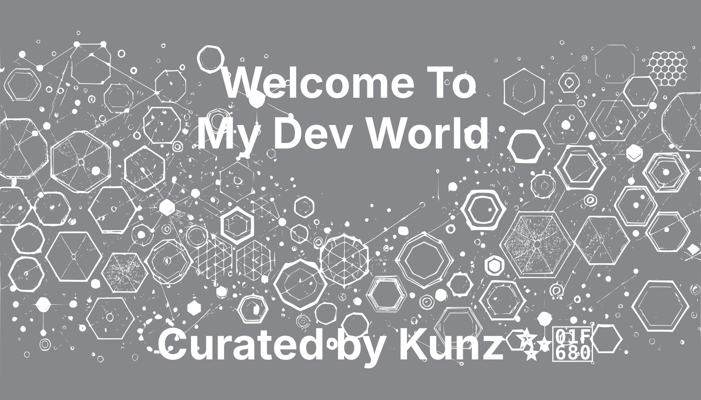

I am a versatile developer and designer specializing in creating efficient, user-friendly applications across multiple
platforms. With a passion for problem-solving and innovative design, I thrive on delivering creative solutions that
drive meaningful impact.

---

## Languages & Tools

| Category                                        | Languages & Tools                                                                                                                                                                                                                                                                                                                                                                                                                                                                                                                                                                                                                                                                                                                                                                                                                                                                                                                                                                                                                                                                                                                              |
|-------------------------------------------------|------------------------------------------------------------------------------------------------------------------------------------------------------------------------------------------------------------------------------------------------------------------------------------------------------------------------------------------------------------------------------------------------------------------------------------------------------------------------------------------------------------------------------------------------------------------------------------------------------------------------------------------------------------------------------------------------------------------------------------------------------------------------------------------------------------------------------------------------------------------------------------------------------------------------------------------------------------------------------------------------------------------------------------------------------------------------------------------------------------------------------------------------|
| **Markup Languages**                            |                                                                                                                                                                                                                                                                                                                                                                                                                                                                                                                                                                                                                                                                                                                                                                                                                                                                |
| **Programming Languages**                       |    ![C#](https://img.shields.io/badge/C%23-ffffff?logo=data%3Aimage%2Fsvg%2Bxml%3Bbase64%2CPHN2ZyBmaWxsPSIjOUI0Rjk2IiByb2xlPSJpbWciIHZpZXdCb3g9IjAgMCAyNCAyNCIgeG1sbnM9Imh0dHA6Ly93d3cudzMub3JnLzIwMDAvc3ZnIj48cGF0aCBkPSJNMS4xOTQgNy41NDN2OC45MTNjMCAxLjEwMy41ODggMi4xMjIgMS41NDQgMi42NzRsNy43MTggNC40NTZhMy4wODYgMy4wODYgMCAwIDAgMy4wODggMGw3LjcxOC00LjQ1NmEzLjA4NyAzLjA4NyAwIDAgMCAxLjU0NC0yLjY3NFY3LjU0M2EzLjA4NCAzLjA4NCAwIDAgMC0xLjU0NC0yLjY3M0wxMy41NDQuNDE0YTMuMDg2IDMuMDg2IDAgMCAwLTMuMDg4IDBMMi43MzggNC44N2EzLjA4NSAzLjA4NSAwIDAgMC0xLjU0NCAyLjY3M1ptNS40MDMgMi45MTR2My4wODdhLjc3Ljc3IDAgMCAwIC43NzIuNzcyLjc3My43NzMgMCAwIDAgLjc3Mi0uNzcyLjc3My43NzMgMCAwIDEgMS4zMTctLjU0Ni43NzUuNzc1IDAgMCAxIC4yMjYuNTQ2IDIuMzE0IDIuMzE0IDAgMSAxLTQuNjMxIDB2LTMuMDg3YzAtLjYxNS4yNDQtMS4yMDMuNjc5LTEuNjM3YTIuMzEyIDIuMzEyIDAgMCAxIDMuMjc0IDBjLjQzNC40MzQuNjc4IDEuMDIzLjY3OCAxLjYzN2EuNzY5Ljc2OSAwIDAgMS0uMjI2LjU0NS43NjcuNzY3IDAgMCAxLTEuMDkxIDAgLjc3Ljc3IDAgMCAxLS4yMjYtLjU0NS43Ny43NyAwIDAgMC0uNzcyLS43NzIuNzcxLjc3MSAwIDAgMC0uNzcyLjc3MlptMTIuMzUgMy4wODdhLjc3Ljc3IDAgMCAxLS43NzIuNzcyaC0uNzcydi43NzJhLjc3My43NzMgMCAwIDEtMS41NDQgMHYtLjc3MmgtMS41NDR2Ljc3MmEuNzczLjc3MyAwIDAgMS0xLjMxNy41NDYuNzc1Ljc3NSAwIDAgMS0uMjI2LS41NDZ2LS43NzJIMTJhLjc3MS43NzEgMCAxIDEgMC0xLjU0NGguNzcydi0xLjU0M0gxMmEuNzcuNzcgMCAxIDEgMC0xLjU0NGguNzcydi0uNzcyYS43NzMuNzczIDAgMCAxIDEuMzE3LS41NDYuNzc1Ljc3NSAwIDAgMSAuMjI2LjU0NnYuNzcyaDEuNTQ0di0uNzcyYS43NzMuNzczIDAgMCAxIDEuNTQ0IDB2Ljc3MmguNzcyYS43NzIuNzcyIDAgMCAxIDAgMS41NDRoLS43NzJ2MS41NDNoLjc3MmEuNzc2Ljc3NiAwIDAgMSAuNzcyLjc3MlptLTMuMDg4LTIuMzE1aC0xLjU0NHYxLjU0M2gxLjU0NHYtMS41NDNaIi8%2BPC9zdmc%2B&style=for-the-badge&color=000000)       |
| **Query Languages**                             |                                                                                                                                                                                                                                                                                                                                                                                                                                                                                                                                                                                                                              |
| **Frameworks**                                  |              |
| **Platforms & OS**                              |                                                                                                                                                                                                                                                                                                                                                                                                                                                                                                                                                                                                                                                                                                                                                                                                                                                                                                                                             |
| **Databases**                                   |                                                                                                                                                                                                                                                                                                                                                                 |
| **Artificial Intelligence**                     |  ![ChatGPT](https://img.shields.io/badge/ChatGPT-000000?style=for-the-badge&logo=data%3Aimage%2Fsvg%2Bxml%3Bbase64%2CPHN2ZyBmaWxsPSIjNzRBQTlDIiByb2xlPSJpbWciIHZpZXdCb3g9IjAgMCAyNCAyNCIgeG1sbnM9Imh0dHA6Ly93d3cudzMub3JnLzIwMDAvc3ZnIj48cGF0aCBkPSJNMjIuMjgxOSA5LjgyMTFhNS45ODQ3IDUuOTg0NyAwIDAgMC0uNTE1Ny00LjkxMDggNi4wNDYyIDYuMDQ2MiAwIDAgMC02LjUwOTgtMi45QTYuMDY1MSA2LjA2NTEgMCAwIDAgNC45ODA3IDQuMTgxOGE1Ljk4NDcgNS45ODQ3IDAgMCAwLTMuOTk3NyAyLjkgNi4wNDYyIDYuMDQ2MiAwIDAgMCAuNzQyNyA3LjA5NjYgNS45OCA1Ljk4IDAgMCAwIC41MTEgNC45MTA3IDYuMDUxIDYuMDUxIDAgMCAwIDYuNTE0NiAyLjkwMDFBNS45ODQ3IDUuOTg0NyAwIDAgMCAxMy4yNTk5IDI0YTYuMDU1NyA2LjA1NTcgMCAwIDAgNS43NzE4LTQuMjA1OCA1Ljk4OTQgNS45ODk0IDAgMCAwIDMuOTk3Ny0yLjkwMDEgNi4wNTU3IDYuMDU1NyAwIDAgMC0uNzQ3NS03LjA3Mjl6bS05LjAyMiAxMi42MDgxYTQuNDc1NSA0LjQ3NTUgMCAwIDEtMi44NzY0LTEuMDQwOGwuMTQxOS0uMDgwNCA0Ljc3ODMtMi43NTgyYS43OTQ4Ljc5NDggMCAwIDAgLjM5MjctLjY4MTN2LTYuNzM2OWwyLjAyIDEuMTY4NmEuMDcxLjA3MSAwIDAgMSAuMDM4LjA1MnY1LjU4MjZhNC41MDQgNC41MDQgMCAwIDEtNC40OTQ1IDQuNDk0NHptLTkuNjYwNy00LjEyNTRhNC40NzA4IDQuNDcwOCAwIDAgMS0uNTM0Ni0zLjAxMzdsLjE0Mi4wODUyIDQuNzgzIDIuNzU4MmEuNzcxMi43NzEyIDAgMCAwIC43ODA2IDBsNS44NDI4LTMuMzY4NXYyLjMzMjRhLjA4MDQuMDgwNCAwIDAgMS0uMDMzMi4wNjE1TDkuNzQgMTkuOTUwMmE0LjQ5OTIgNC40OTkyIDAgMCAxLTYuMTQwOC0xLjY0NjR6TTIuMzQwOCA3Ljg5NTZhNC40ODUgNC40ODUgMCAwIDEgMi4zNjU1LTEuOTcyOFYxMS42YS43NjY0Ljc2NjQgMCAwIDAgLjM4NzkuNjc2NWw1LjgxNDQgMy4zNTQzLTIuMDIwMSAxLjE2ODVhLjA3NTcuMDc1NyAwIDAgMS0uMDcxIDBsLTQuODMwMy0yLjc4NjVBNC41MDQgNC41MDQgMCAwIDEgMi4zNDA4IDcuODcyem0xNi41OTYzIDMuODU1OEwxMy4xMDM4IDguMzY0IDE1LjExOTIgNy4yYS4wNzU3LjA3NTcgMCAwIDEgLjA3MSAwbDQuODMwMyAyLjc5MTNhNC40OTQ0IDQuNDk0NCAwIDAgMS0uNjc2NSA4LjEwNDJ2LTUuNjc3MmEuNzkuNzkgMCAwIDAtLjQwNy0uNjY3em0yLjAxMDctMy4wMjMxbC0uMTQyLS4wODUyLTQuNzczNS0yLjc4MThhLjc3NTkuNzc1OSAwIDAgMC0uNzg1NCAwTDkuNDA5IDkuMjI5N1Y2Ljg5NzRhLjA2NjIuMDY2MiAwIDAgMSAuMDI4NC0uMDYxNWw0LjgzMDMtMi43ODY2YTQuNDk5MiA0LjQ5OTIgMCAwIDEgNi42ODAyIDQuNjZ6TTguMzA2NSAxMi44NjNsLTIuMDItMS4xNjM4YS4wODA0LjA4MDQgMCAwIDEtLjAzOC0uMDU2N1Y2LjA3NDJhNC40OTkyIDQuNDk5MiAwIDAgMSA3LjM3NTctMy40NTM3bC0uMTQyLjA4MDVMOC43MDQgNS40NTlhLjc5NDguNzk0OCAwIDAgMC0uMzkyNy42ODEzem0xLjA5NzYtMi4zNjU0bDIuNjAyLTEuNDk5OCAyLjYwNjkgMS40OTk4djIuOTk5NGwtMi41OTc0IDEuNDk5Ny0yLjYwNjctMS40OTk3WiIvPjwvc3ZnPg%3D%3D) ![Grok](https://img.shields.io/badge/Grok-ffffff?logo=data%3Aimage%2Fsvg%2Bxml%3Bbase64%2CPHN2ZyBmaWxsPSIjRkZGRkZGIiAgZmlsbC1ydWxlPSJldmVub2RkIiBoZWlnaHQ9IjFlbSIgc3R5bGU9ImZsZXg6bm9uZTtsaW5lLWhlaWdodDoxIiB2aWV3Qm94PSIwIDAgMjQgMjQiIHdpZHRoPSIxZW0iIHhtbG5zPSJodHRwOi8vd3d3LnczLm9yZy8yMDAwL3N2ZyI%2BPHBhdGggZD0iTTkuMjcgMTUuMjlsNy45NzgtNS44OTdjLjM5MS0uMjkuOTUtLjE3NyAxLjEzNy4yNzIuOTggMi4zNjkuNTQyIDUuMjE1LTEuNDEgNy4xNjktMS45NTEgMS45NTQtNC42NjcgMi4zODItNy4xNDkgMS40MDZsLTIuNzExIDEuMjU3YzMuODg5IDIuNjYxIDguNjExIDIuMDAzIDExLjU2Mi0uOTUzIDIuMzQxLTIuMzQ0IDMuMDY2LTUuNTM5IDIuMzg4LTguNDJsLjAwNi4wMDdjLS45ODMtNC4yMzIuMjQyLTUuOTI0IDIuNzUtOS4zODMuMDYtLjA4Mi4xMi0uMTY0LjE3OS0uMjQ4bC0zLjMwMSAzLjMwNXYtLjAxTDkuMjY3IDE1LjI5Mk03LjYyMyAxNi43MjNjLTIuNzkyLTIuNjctMi4zMS02LjgwMS4wNzEtOS4xODQgMS43NjEtMS43NjMgNC42NDctMi40ODMgNy4xNjYtMS40MjVsMi43MDUtMS4yNWE3LjgwOCA3LjgwOCAwIDAwLTEuODI5LTFBOC45NzUgOC45NzUgMCAwMDUuOTg0IDUuODNjLTIuNTMzIDIuNTM2LTMuMzMgNi40MzYtMS45NjIgOS43NjQgMS4wMjIgMi40ODctLjY1MyA0LjI0Ni0yLjM0IDYuMDIyLS41OTkuNjMtMS4xOTkgMS4yNTktMS42ODIgMS45MjVsNy42Mi02LjgxNSI%2BPC9wYXRoPjwvc3ZnPg%3D%3D&style=for-the-badge&color=000000)     |
| **Machine Learning**                            |      |
| **Cloud**                                       |       ![Amazon Cloud](https://img.shields.io/badge/Amazon_Cloud-000000?style=for-the-badge&logo=data%3Aimage%2Fsvg%2Bxml%3Bbase64%2CPHN2ZyBmaWxsPSIjRkY5OTAwIiByb2xlPSJpbWciIHZpZXdCb3g9IjAgMCAyNCAyNCIgeG1sbnM9Imh0dHA6Ly93d3cudzMub3JnLzIwMDAvc3ZnIj48cGF0aCBkPSJNNi43NiAxMC4wNGMwIC4zLjAzLjU0LjA5LjcxLjA2LjE4LjE0LjM3LjI2LjU4LjA0LjA2LjA2LjEzLjA2LjE4IDAgLjA4LS4wNS4xNi0uMTUuMjRsLS41LjM0YS4zOC4zOCAwIDAgMS0uMjEuMDdjLS4wOCAwLS4xNi0uMDQtLjI0LS4xMWEyLjQ3IDIuNDcgMCAwIDEtLjI5LS4zOCA2LjE4IDYuMTggMCAwIDEtLjI1LS40N2MtLjYyLjczLTEuNDEgMS4xLTIuMzUgMS4xLS42NyAwLTEuMjEtLjE5LTEuNi0uNTctLjM5LS4zOC0uNTktLjg5LS41OS0xLjUzIDAtLjY4LjI0LTEuMjMuNzMtMS42NC40OS0uNDEgMS4xMy0uNjIgMS45Ni0uNjIuMjcgMCAuNTUuMDIuODUuMDYuMy4wNC42LjEuOTIuMTh2LS41OGMwLS42MS0uMTMtMS4wMy0uMzgtMS4yOC0uMjYtLjI1LS42OS0uMzctMS4zLS4zNy0uMjggMC0uNTcuMDMtLjg2LjEtLjI5LjA3LS41OC4xNi0uODYuMjdhMi4yOSAyLjI5IDAgMCAxLS4yOC4xLjQ5LjQ5IDAgMCAxLS4xMy4wMmMtLjExIDAtLjE3LS4wOC0uMTctLjI1di0uMzljMC0uMTMuMDItLjIyLjA2LS4yOGEuNi42IDAgMCAxIC4yMi0uMTdjLjI4LS4xNC42MS0uMjYgMS0uMzZhNC44NCA0Ljg0IDAgMCAxIDEuMjUtLjE1Yy45NSAwIDEuNjQuMjIgMi4wOS42NS40NC40My42NiAxLjA4LjY2IDEuOTZ2Mi41OXptLTMuMjQgMS4yMWMuMjYgMCAuNTMtLjA1LjgyLS4xNC4yOS0uMS41NC0uMjcuNzYtLjUxLjEzLS4xNS4yMi0uMzIuMjctLjUxLjA1LS4xOS4wOC0uNDIuMDgtLjY5di0uMzRhNi42NiA2LjY2IDAgMCAwLS43My0uMTQgNi4wMiA2LjAyIDAgMCAwLS43NS0uMDVjLS41NCAwLS45My4xLTEuMTkuMzItLjI2LjIxLS4zOS41Mi0uMzkuOTIgMCAuMzguMS42Ni4yOS44NS4xOS4yLjQ3LjMuODQuM3ptNi40MS44NmMtLjE0IDAtLjI0LS4wMi0uMy0uMDgtLjA2LS4wNS0uMTItLjE2LS4xNy0uMzFMNy41OSA1LjU1YTEuNCAxLjQgMCAwIDEtLjA3LS4zMmMwLS4xMy4wNi0uMi4xOS0uMmguNzhjLjE1IDAgLjI2LjAzLjMxLjA4LjA3LjA1LjExLjE2LjE2LjMxbDEuMzQgNS4yOCAxLjI1LTUuMjhjLjA0LS4xNi4wOS0uMjYuMTUtLjMxYS41NS41NSAwIDAgMSAuMzItLjA4aC42NGMuMTUgMCAuMjYuMDMuMzIuMDguMDYuMDUuMTIuMTYuMTUuMzFsMS4yNiA1LjM1IDEuMzgtNS4zNWMuMDUtLjE2LjEtLjI2LjE2LS4zMWEuNTIuNTIgMCAwIDEgLjMxLS4wOGguNzRjLjEzIDAgLjIuMDcuMi4yIDAgLjA0LS4wMS4wOC0uMDIuMTNhMS4xNCAxLjE0IDAgMCAxLS4wNi4ybC0xLjkyIDYuMTdjLS4wNS4xNi0uMS4yNi0uMTcuMzFhLjUxLjUxIDAgMCAxLS4zLjA4aC0uNjljLS4xNSAwLS4yNi0uMDItLjMyLS4wOC0uMDYtLjA2LS4xMi0uMTYtLjE1LS4zMmwtMS4yNC01LjE1LTEuMjMgNS4xNGMtLjA0LjE2LS4wOS4yNi0uMTUuMzItLjA3LjA2LS4xOC4wOC0uMzIuMDh6bTEwLjI2LjIxYy0uNDEgMC0uODMtLjA1LTEuMjMtLjE0LS40LS4xLS43MS0uMi0uOTItLjMyLS4xMy0uMDctLjIxLS4xNS0uMjUtLjIyYS41Ni41NiAwIDAgMS0uMDUtLjIydi0uNDFjMC0uMTcuMDYtLjI1LjE4LS4yNS4wNSAwIC4xLjAxLjE0LjAyLjA1LjAyLjEyLjA1LjIuMDguMjcuMTIuNTcuMjEuODguMjguMzIuMDYuNjMuMS45NS4xLjUgMCAuODktLjA5IDEuMTctLjI2YS44Ni44NiAwIDAgMCAuNDEtLjc2Ljc4Ljc4IDAgMCAwLS4yMS0uNTZjLS4xNC0uMTUtLjQyLS4yOS0uODEtLjQxbC0xLjE2LS4zNmMtLjU4LS4xOC0xLjAxLS40NS0xLjI4LS44MWExLjkgMS45IDAgMCAxLS40LTEuMTZjMC0uMzQuMDctLjYzLjIyLS44OS4xNC0uMjYuMzQtLjQ4LjU3LS42NS4yNC0uMTguNTEtLjMyLjgzLS40MS4zMi0uMS42Ni0uMTQgMS4wMS0uMTQuMTcgMCAuMzYuMDEuNTQuMDMuMTguMDIuMzUuMDYuNTIuMDkuMTYuMDQuMzEuMDguNDYuMTMuMTQuMDUuMjYuMS4zNC4xNGEuNjkuNjkgMCAwIDEgLjI0LjIuNDMuNDMgMCAwIDEgLjA3LjI2di4zOGMwIC4xNy0uMDYuMjYtLjE4LjI2YS44My44MyAwIDAgMS0uMy0uMSAzLjY1IDMuNjUgMCAwIDAtMS41My0uMzFjLS40NiAwLS44MS4wNy0xLjA2LjIyLS4yNS4xNS0uMzguMzgtLjM4LjcxIDAgLjIyLjA4LjQyLjI0LjU3LjE2LjE1LjQ1LjMuODguNDRsMS4xMy4zNmMuNTcuMTguOTkuNDQgMS4yNC43Ny4yNS4zMy4zNy43LjM3IDEuMTIgMCAuMzQtLjA3LjY2LS4yMS45My0uMTQuMjctLjM0LjUxLS41OC43LS4yNS4yLS41NC4zNC0uODkuNDUtLjM2LjExLS43My4xNy0xLjE0LjE3ek0yMS43IDE2LjIxYy0yLjYzIDEuOTQtNi40NCAyLjk3LTkuNzIgMi45Ny00LjYgMC04Ljc0LTEuNy0xMS44Ny00LjUzLS4yNS0uMjItLjAyLS41My4yNy0uMzUgMy4zOCAxLjk2IDcuNTYgMy4xNSAxMS44OCAzLjE1IDIuOTEgMCA2LjExLS42MSA5LjA2LTEuODUuNDQtLjIuODEuMjkuMzguNjF6TTIyLjc5IDE0Ljk2Yy0uMzQtLjQzLTIuMjItLjIxLTMuMDctLjEtLjI2LjAzLS4yOS0uMTktLjA2LS4zNiAxLjUtMS4wNSAzLjk3LS43NSA0LjI1LS40LjI5LjM2LS4wOCAyLjgzLTEuNDkgNC4wMS0uMjEuMTgtLjQyLjA5LS4zMy0uMTUuMzItLjc5IDEuMDMtMi41Ny42OS0yLjk5eiIvPjwvc3ZnPg%3D%3D)                                                                                                                                                                                                                                                                                                       |
| **Design**                                      | ![Adobe Photoshop](https://img.shields.io/badge/Adobe_Photoshop-000000?style=for-the-badge&logo=data%3Aimage%2Fsvg%2Bxml%3Bbase64%2CPHN2ZyBmaWxsPSIjMzFBOEZGIiByb2xlPSJpbWciIHZpZXdCb3g9IjAgMCAyNCAyNCIgeG1sbnM9Imh0dHA6Ly93d3cudzMub3JnLzIwMDAvc3ZnIj48cGF0aCBkPSJNOS44NSA4LjQyYy0uMzctLjE1LS43Ny0uMjEtMS4xOC0uMi0uMjYgMC0uNDkgMC0uNjguMDEtLjItLjAxLS4zNCAwLS40MS4wMXYzLjM2Yy4xNC4wMS4yNy4wMi4zOS4wMmguNTNjLjM5IDAgLjc4LS4wNiAxLjE1LS4xOC4zMi0uMDkuNi0uMjguODItLjUzLjIxLS4yNS4zMS0uNTkuMzEtMS4wMy4wMS0uMzEtLjA3LS42Mi0uMjMtLjg5LS4xNy0uMjYtLjQxLS40Ni0uNy0uNTd6TTE5Ljc1LjNINC4yNUMxLjkuMyAwIDIuMiAwIDQuNTV2MTQuODk5YzAgMi4zNSAxLjkgNC4yNSA0LjI1IDQuMjVoMTUuNWMyLjM1IDAgNC4yNS0xLjkgNC4yNS00LjI1VjQuNTVDMjQgMi4yIDIyLjEuMyAxOS43NS4zem0tNy4zOTEgMTEuNjVjLS4zOTkuNTYtLjk1OS45OC0xLjYwOSAxLjIyLS42OC4yNS0xLjQzLjM0LTIuMjUuMzQtLjI0IDAtLjQgMC0uNS0uMDFzLS4yNC0uMDEtLjQzLS4wMXYzLjIwOWMuMDEuMDctLjA0LjEzMS0uMTEuMTQxSDUuNTJjLS4wOCAwLS4xMi0uMDQxLS4xMi0uMTMxVjYuNDJjMC0uMDcuMDMtLjExLjEtLjExLjE3IDAgLjMzIDAgLjU2LS4wMS4yNC0uMDEuNDktLjAxLjc2LS4wMnMuNTYtLjAxLjg3LS4wMmMuMzEtLjAxLjYxLS4wMS45MS0uMDEuODIgMCAxLjUuMSAyLjA2LjMxLjUuMTcuOTYuNDUgMS4zNC44Mi4zMi4zMi41Ny43MS43MyAxLjE0LjE0OS40Mi4yMjkuODUuMjI5IDEuMy4wMDEuODYtLjE5OSAxLjU3LS42IDIuMTN6bTcuMDkxIDMuODljLS4yOC40LS42NzEuNzA5LTEuMTIuODkxLS40OS4yMDktMS4wOS4zMTgtMS44MTEuMzE4LS40NTkgMC0uOTEtLjAzOS0xLjM1OS0uMTI5LS4zNS0uMDYxLS43LS4xNy0xLjAyLS4zMi0uMDctLjAzOS0uMTIxLS4xMDktLjExMS0uMTg5di0xLjc0YzAtLjAyOS4wMTEtLjA3LjA0MS0uMDkuMDI5LS4wMi4wNi0uMDEuMDkuMDEuMzkuMjMuOC4zOTEgMS4yNC40OS4zNzkuMS43NzkuMTUgMS4xOC4xNS4zOCAwIC42NS0uMDUxLjgzLS4xNDEuMTYtLjA3LjI3LS4yNC4yNy0uNDIgMC0uMTQxLS4wOC0uMjctLjI0LS40LS4xNi0uMTI5LS40ODktLjI3OS0uOTc5LS40NzEtLjUxLS4xOC0uOTc5LS40Mi0xLjQyLS43MTktLjMxLS4yMjEtLjU2OS0uNTEtLjc2MS0uODUtLjE1OS0uMzItLjIzOS0uNjctLjIyOS0xLjAyMSAwLS40My4xMi0uODQuMzQxLTEuMjEuMjUtLjQuNjE5LS43MiAxLjA0OS0uOTIuNDY5LS4yMzkgMS4wNTktLjM0OSAxLjc2OS0uMzQ5LjQxIDAgLjgzLjAzIDEuMjQuMDkuMy4wNC41OS4xMi44Ni4yMy4wMzkuMDEuMDguMDUuMS4wOS4wMS4wNC4wMi4wOC4wMi4xMnYxLjYzYzAgLjA0LS4wMi4wOC0uMDUuMS0uMDkuMDItLjE0LjAyLS4xOCAwLS4zLS4xNi0uNjItLjI3LS45Ni0uMzQtLjM3LS4wOC0uNzQtLjEzLTEuMTItLjEzLS4yLS4wMS0uNDEuMDItLjYwMS4wNy0uMTI5LjAzLS4yNC4xLS4zMS4yLS4wNS4wOC0uMDguMTgtLjA4LjI3cy4wNC4xOC4xMDEuMjZjLjA5LjExLjIwOS4yLjM0LjI3LjIyOS4xMi40Ny4yMy43MDkuMzMuNTQxLjE4IDEuMDYxLjQzIDEuNTQxLjczLjMzLjIwOS42LjQ5Ljc4OS44My4xNi4zMTguMjQuNjcuMjMgMS4wMjkuMDExLjQ3MS0uMTI5Ljk0LS4zODkgMS4zMzF6Ii8%2BPC9zdmc%2B) ![Adobe Premiere Pro](https://img.shields.io/badge/Adobe_Premiere_Pro-000000?style=for-the-badge&logo=data%3Aimage%2Fsvg%2Bxml%3Bbase64%2CPHN2ZyBmaWxsPSIjOTk5OUZGIiByb2xlPSJpbWciIHZpZXdCb3g9IjAgMCAyNCAyNCIgeG1sbnM9Imh0dHA6Ly93d3cudzMub3JnLzIwMDAvc3ZnIj48cGF0aCBkPSJNMTAuMTUgOC40MmEyLjkzIDIuOTMgMCAwMC0xLjE4LS4yIDEzLjkgMTMuOSAwIDAwLTEuMDkuMDJ2My4zNmwuMzkuMDJoLjUzYy4zOSAwIC43OC0uMDYgMS4xNS0uMTguMzItLjA5LjYtLjI4LjgyLS41My4yMS0uMjUuMzEtLjU5LjMxLTEuMDNhMS40NSAxLjQ1IDAgMDAtLjkzLTEuNDZ6TTE5Ljc1LjNINC4yNUE0LjI1IDQuMjUgMCAwMDAgNC41NXYxNC45YzAgMi4zNSAxLjkgNC4yNSA0LjI1IDQuMjVoMTUuNWMyLjM1IDAgNC4yNS0xLjkgNC4yNS00LjI1VjQuNTVDMjQgMi4yIDIyLjEuMyAxOS43NS4zem0tNy4wOSAxMS42NWMtLjQuNTYtLjk2Ljk4LTEuNjEgMS4yMi0uNjguMjUtMS40My4zNC0yLjI1LjM0bC0uNS0uMDEtLjQzLS4wMXYzLjIxYS4xMi4xMiAwIDAxLS4xMS4xNEg1LjgyYy0uMDggMC0uMTItLjA0LS4xMi0uMTNWNi40MmMwLS4wNy4wMy0uMTEuMS0uMTFsLjU2LS4wMS43Ni0uMDIuODctLjAyLjkxLS4wMWMuODIgMCAxLjUuMSAyLjA2LjMxLjUuMTcuOTYuNDUgMS4zNC44Mi4zMi4zMi41Ny43MS43MyAxLjE0LjE1LjQyLjIzLjg1LjIzIDEuMyAwIC44Ni0uMiAxLjU3LS42IDIuMTN6bTYuODItMy4xNXYxLjk1YzAgLjA4LS4wNS4xMS0uMTYuMTFhNC4zNSA0LjM1IDAgMDAtMS45Mi4zN2MtLjE5LjA5LS4zNy4yMS0uNTEuMzd2NS4xYzAgLjEtLjA0LjE0LS4xMy4xNGgtMS45N2EuMTQuMTQgMCAwMS0uMTYtLjEydi01LjU4bC0uMDEtLjc1LS4wMi0uNzhjMC0uMjMtLjAyLS40NS0uMDQtLjY4YS4xLjEgMCAwMS4wNy0uMTFoMS43OGMuMSAwIC4xOC4wNy4yLjE2YTMuMDMgMy4wMyAwIDAxLjEzLjkyYy4zLS4zNS42Ny0uNjQgMS4wOC0uODZhMy4xIDMuMSAwIDAxMS41Mi0uMzljLjA3LS4wMS4xMy4wNC4xNC4xMXYuMDR6Ii8%2BPC9zdmc%2B) ![Canva](https://img.shields.io/badge/Canva-000000?style=for-the-badge&logo=data%3Aimage%2Fsvg%2Bxml%3Bbase64%2CPHN2ZyBmaWxsPSIjMDBDNENDIiByb2xlPSJpbWciIHZpZXdCb3g9IjAgMCAyNCAyNCIgeG1sbnM9Imh0dHA6Ly93d3cudzMub3JnLzIwMDAvc3ZnIj48cGF0aCBkPSJNMTIgMEM1LjM3MyAwIDAgNS4zNzMgMCAxMnM1LjM3MyAxMiAxMiAxMiAxMi01LjM3MyAxMi0xMlMxOC42MjcgMCAxMiAwek02Ljk2MiA3LjY4Yy43NTQgMCAxLjMzNy41NDkgMS40MDUgMS4yLjA2OS41ODMtLjE3MSAxLjA5Ny0uODIyIDEuNDA2LS4zNDMuMTcxLS40OC4xNzItLjU0OS4wNjktLjAzNC0uMDY5IDAtLjEzNy4wNjktLjIwNi42MTctLjUxNC42MTctLjkyNi41NDgtMS41MDgtLjAzNC0uMzc4LS4zMDgtLjYxOC0uNTgzLS42MTgtMS4yIDAtMi45MTQgMi42NzQtMi42NzQgNC42MjkuMTAzLjc1NC41NDkgMS42NDYgMS41MDkgMS42NDYuMzA4IDAgLjY1LS4xMDMuOTYtLjI0LjUtLjI2NC43OTktLjQ3IDEuMDk3LS44LS4wNzMtLjg4NS43MDQtMi4wNDYgMS44NTEtMi4wNDYuNTE1IDAgLjkyNi4yMDUuOTYuNTgzLjA2OC41MTQtLjM3Ny41ODItLjUxNC41ODJzLS4zNzgtLjAzNC0uMzc4LS4xN2MtLjAzNC0uMTM4LjMwOS0uMDcuMjc1LS4zNzgtLjAzNS0uMjA2LS4yNC0uMjc0LS40NDYtLjI3NC0uNzIgMC0xLjEzMS45OTQtMS4wMjkgMS42MTEuMDM1LjI3NS4xNzIuNTQ5LjQ0Ny41NDkuMjA1IDAgLjUxNC0uMzEuNjE3LS43NTUuMDY4LS4zMDguMzQzLS41MTQuNTgzLS41MTQuMTAyIDAgLjE3LjAzNC4yMDUuMTcxdi4xMzhjLS4wMzQuMTM3LS4xMzcuNTQ4LS4xMDIuNjUxIDAgLjA2OS4wMzQuMTcxLjE3LjE3MS4wOTIgMCAuNDM2LS4xOC43NzctLjQ1OS4xMTctLjU5LjI1My0xLjI5OC4yNTMtMS4zNTcuMDM0LS4yNC4xMzctLjQ4LjYxNy0uNDguMTAzIDAgLjE3MS4wMzQuMjA1LjE3MXYuMTM4bC0uMTM2LjYxN2MuNDQ1LS41ODMgMS4wOTctLjk5NCAxLjUwOC0uOTk0LjE3MiAwIC4zMDkuMTAyLjMwOS4yNzQgMCAuMTAzIDAgLjI3NC0uMDY5LjQ0Ni0uMTM3LjM3Ny0uMzA5Ljk2LS40MTIgMS40NzQgMCAuMTM3LjAzNS4yNzQuMjA3LjI3NC4xNzEgMCAuNjg1LS4yMDYgMS4wOTYtLjc1NGwuMDA3LS4wMDRjLS4wMDItLjA2OC0uMDA3LS4xMzQtLjAwNy0uMjAyIDAtLjQxMS4wMzUtLjc1NC4xMDQtLjk5NC4wNjgtLjI3NC40MTEtLjUxNC42MTctLjUxNC4xMDMgMCAuMjA1LjA2OS4yMDUuMTcxIDAgLjAzNSAwIC4xMDMtLjAzNC4xMzctLjEzNy40NDYtLjI0Ljg1Ny0uMjQgMS4yNjkgMCAuMjQuMDM0LjU4Mi4xMDIuNzg4IDAgLjAzNC4wMzUuMDY5LjA3LjA2OS4wNjggMCAuNTQ4LS40NDUuODktMS4wMjgtLjMwOC0uMjA2LS40OC0uNTQ5LS40OC0uOTYgMC0uNzIuNDQ2LTEuMDk3Ljg1OC0xLjA5Ny4zNDMgMCAuNjE3LjI0LjYxNy43MiAwIC4zMDgtLjEwMy42NS0uMjc0Ljk2aC4xMDJhLjc3Ljc3IDAgMCAwIC41ODQtLjI0LjI5My4yOTMgMCAwIDEgLjEzNC0uMTE3Yy4zMzUtLjQyNS44My0uNzQgMS40MS0uNzQuNDggMCAuOTI0LjIwNS45NTkuNTgyLjA2OC41MTUtLjM3OC42MTgtLjUxNS42MThsLS4wMDItLjAwMmMtLjEzOCAwLS4zNzctLjAzNS0uMzc3LS4xNzIgMC0uMTM3LjMwOS0uMDY4LjI3NC0uMzc2LS4wMzQtLjIwNi0uMjQtLjI3NS0uNDQ2LS4yNzUtLjY4NiAwLTEuMTMuODkxLTEuMDI4IDEuNjExLjAzNC4yNzUuMTcxLjU4My40NDUuNTgzLjIwNiAwIC41MTUtLjMwOC42NTItLjc1NC4wNjgtLjI3NC4zNDMtLjUxNC41ODMtLjUxNC4xMDMgMCAuMTcuMDM0LjIwNS4xNzEgMCAuMDY5IDAgLjIwNi0uMTM3LjY1Mi0uMTcuMzA4LS4xNzEuNDgtLjEzNy42MTcuMDM0LjI3NC4xNzEuNDguMzA5LjU4My4wMzQuMDM0LjA2OC4xMDIuMDY4LjEwMiAwIC4wNjktLjAzNC4xMzgtLjEzNy4xMzgtLjAzNCAwLS4wNjggMC0uMTAzLS4wMzUtLjUxNC0uMjA1LS43Mi0uNTQ4LS43ODktLjg5MS0uMjA1LjI0LS40NDUuMzc3LS43Mi4zNzctLjQ0NSAwLS44OS0uNDExLS45Ni0uOTI2YTEuNjA5IDEuNjA5IDAgMCAxIC4wNzUtLjY0OWMtLjIwMy4xMy0uNDIyLjIwMy0uNjIzLjIwM2gtLjE3Yy0uNDQ3LjY1Mi0uOTI3IDEuMDk4LTEuMjcgMS4zMDNhLjg5Ni44OTYgMCAwIDEtLjM3Ny4xMDRjLS4wNjggMC0uMTcxLS4wMzUtLjIwNS0uMTA0LS4wOTUtLjE1Mi0uMTU2LS4zOTItLjE5My0uNjY3LS40ODEuNTI3LTEuMTQ1LjgwNS0xLjQ1My44MDUtLjM0MyAwLS41NDgtLjIwNi0uNTgyLS41NXYtLjM3NmMuMTAyLS43NTQuMzc3LTEuMi4zNzctMS4zMzdhLjA3NC4wNzQgMCAwIDAtLjA2OS0uMDdjLS4yNCAwLTEuMDI4LjgyNC0xLjE2NiAxLjM3M2wtLjEwMy40NDVjLS4wNjguMzA5LS4zNzcuNTE1LS41ODIuNTE1LS4xMDMgMC0uMTcyLS4wMzUtLjIwNi0uMTcydi0uMTM3bC4wNDYtLjIzM2MtLjQzNS4zMS0uODcuNTA4LTEuMDc1LjUwOC0uMzA4IDAtLjQ4LS4xNzItLjUxNC0uNDEyLS4yMDYuMjc0LS40NDUuNDEyLS43NTQuNDEyLS4zNTIgMC0uNjk2LS4yNC0uODYyLS41OTMtLjI0NC4yNzUtLjUyMy41NTMtLjg1Mi43NjQtLjQ4LjMwOS0xLjAyOC41NDktMS42OC41NDktLjU4MiAwLTEuMDk3LS4zMDktMS4zNzEtLjU4My0uNDEyLS4zNzctLjY1MS0uOTYtLjY4Ni0xLjUwOS0uMjA1LTEuNjguODIzLTMuODQgMi40LTQuOC4zNzgtLjIwNS43NTUtLjM0MyAxLjEzMi0uMzQzem05Ljc3IDMuMjkxYy0uMTA0IDAtLjE3Mi4xNzItLjE3Mi4zNDMgMCAuMjc0LjEzNy41ODMuMzA5Ljc1NWExLjc0IDEuNzQgMCAwIDAgLjEwMi0uNTgzYzAtLjM0My0uMTM3LS41MTUtLjI0LS41MTV6Ii8%2BPC9zdmc%2B)                                                                                                                                                                                                                                                                                                                                                                                                                                                |
| **ETL**                                         |                                                                                                                                                                                                                                                                                                                                                                                                                                                                                                                                                                                                                                                                                                                                                                                                                                                                                                                                                                                                                                       |
| **Tools & Collaboration**                       |    ![SharePoint](https://img.shields.io/badge/SharePoint-000000?style=for-the-badge&logo=data%3Aimage%2Fsvg%2Bxml%3Bbase64%2CPHN2ZyBmaWxsPSIjMDA3OEQ0IiByb2xlPSJpbWciIHZpZXdCb3g9IjAgMCAyNCAyNCIgeG1sbnM9Imh0dHA6Ly93d3cudzMub3JnLzIwMDAvc3ZnIj48cGF0aCBkPSJNMjQgMTMuNXEwIDEuMjQyLS40NzUgMi4zMzItLjQ3NCAxLjA5LTEuMjg5IDEuOTA0LS44MTQuODE1LTEuOTA0IDEuMjktMS4wOS40NzQtMi4zMzIuNDc0LS43NjIgMC0xLjUyMy0uMi0uMTA2Ljk5Ny0uNTU3IDEuODU4LS40NTEuODYyLTEuMTU0IDEuNDk0LS43MDQuNjMzLTEuNjA2Ljk5LS45MDIuMzU4LTEuOTEuMzU4LTEuMDkgMC0yLjA0NS0uNDE2LS45NTUtLjQxNi0xLjY2NC0xLjEyNS0uNzA5LS43MDktMS4xMjUtMS42NjRRNiAxOS44NCA2IDE4Ljc1cTAtLjE4OC4wMTgtLjM3NS4wMTctLjE4OC4wNC0uMzc1SC45OTdxLS40MSAwLS43MDMtLjI5M1QwIDE3LjAwNFY2Ljk5NnEwLS40MS4yOTMtLjcwM1QuOTk2IDZoMy41NHEuMTQtMS4yNzcuNzI2LTIuMzczLjU4Ni0xLjA5NiAxLjQ4OC0xLjkwNFE3LjY1Mi45MTQgOC44MDcuNDU3IDkuOTYgMCAxMS4yNSAwcTEuMzk1IDAgMi42MjUuNTMzVDE2LjAyIDEuOThxLjkxNC45MTUgMS40NDcgMi4xNDVUMTggNi43NXEwIC4xODgtLjAxMi4zNzUtLjAxMS4xODgtLjAzNS4zNzUgMS4yNDIgMCAyLjM0NC40NjkgMS4xMDEuNDY4IDEuOTI4IDEuMjc3LjgyNi44MDkgMS4zIDEuOTA0UTI0IDEyLjI0NiAyNCAxMy41em0tMTIuNzUtMTJxLS45NzMgMC0xLjg1Ny4zNC0uODg1LjM0LTEuNTc3Ljk0My0uNjkxLjYwNC0xLjE1NCAxLjQzUTYuMiA1LjAzOSA2LjA2IDZoNC45NDVxLjQxIDAgLjcwMy4yOTN0LjI5My43MDN2NC45NDVsLjIxLS4wMzVxLjIxMi0uNzUuNjEtMS40MjQuMzk5LS42NzMuOTQ0LTEuMjE4LjU0NS0uNTQ1IDEuMjEzLS45NDQuNjY4LS4zOTggMS40My0uNjEuMDkzLS41MDMuMDkzLS45NiAwLTEuMDktLjQxNi0yLjA0NS0uNDE2LS45NTUtMS4xMjUtMS42NjQtLjcwOS0uNzA5LTEuNjY0LTEuMTI1UTEyLjM0IDEuNSAxMS4yNSAxLjV6TTYuMTE3IDE1LjkwMnEuNTQgMCAxLjA2LS4xMTEuNTIyLS4xMTEuOTMyLS4zNy40MS0uMjU3LjY2Mi0uNjc5LjI1Mi0uNDIyLjI1Mi0xLjA1NSAwLS42MzItLjI2My0xLjA1NC0uMjY0LS40MjItLjY2Mi0uNzAzLS4zOTktLjI4Mi0uODU2LS40NjNsLS44NTUtLjM0cS0uMzk5LS4xNTgtLjY2Mi0uMzM0LS4yNjQtLjE3Ni0uMjY0LS40NDUgMC0uMi4xNC0uMzIzLjE0MS0uMTIzLjMzNS0uMTkzLjE5My0uMDcuNDA0LS4wOTQuMjEtLjAyMy4zNTEtLjAyMy41OTggMCAxLjA1NS4xNTIuNDU3LjE1My45NS40NTdWOC41NDNxLS4yODItLjA4Mi0uNTIyLS4xNC0uMjQtLjA2LS40NzUtLjEtLjIzNC0uMDQxLS40ODYtLjA1OS0uMjUyLS4wMTctLjU1Ny0uMDE3LS41MTUgMC0xLjA1NC4xMTctLjU0LjExNy0uOTc5LjM3NS0uNDQuMjU4LS43MTUuNjgtLjI3NS40MjEtLjI3NSAxLjAzIDAgLjU5OC4yNjMuOTk3LjI2NC4zOTguNjYzLjY4LjM5OC4yOC44NTUuNDc0bC44NTYuMzYzcS4zOTguMTcuNjYyLjM1OC4yNjMuMTg3LjI2My40NTcgMCAuMjIyLS4xMjMuMzUxLS4xMjMuMTMtLjMxLjItLjE4OC4wNy0uMzkzLjA4Ny0uMjA1LjAxOC0uMzY5LjAxOC0uNzAzIDAtMS4yNDgtLjIzNC0uNTQ1LS4yMzUtMS4xMDctLjYyMXYxLjg3NXExLjE5NS40NjggMi40NzIuNDY4ek0xMS4yNSAyMi41cS43NzMgMCAxLjQ1My0uMjkzdDEuMTktLjgwM3EuNTEtLjUxLjgwOC0xLjE5NS4yOTktLjY4Ni4yOTktMS40NTkgMC0uNjY4LS4yMjMtMS4yNzctLjIyMi0uNjEtLjYyLTEuMDk2LS40LS40ODYtLjk1LS44MjYtLjU1LS4zNC0xLjIwNy0uNDh2MS45MzNxMCAuNDEtLjI5My43MDN0LS43MDMuMjkzSDcuNTdxLS4wNy4zNzUtLjA3Ljc1IDAgLjc3My4yOTMgMS40NTl0LjgwMyAxLjE5NXEuNTEuNTEgMS4xOTUuODAzLjY4Ni4yOTMgMS40NTkuMjkzek0xOCAxOHEuOTI2IDAgMS43NDYtLjM1Mi44Mi0uMzUxIDEuNDM2LS45NjYuNjE1LS42MTYuOTY2LTEuNDMuMzUyLS44MTUuMzUyLTEuNzUyIDAtLjkyNi0uMzUyLTEuNzQ2LS4zNTEtLjgyLS45NjYtMS40MzYtLjYxNi0uNjE1LTEuNDM2LS45NjZRMTguOTI2IDkgMTggOXQtMS43NC4zNTdxLS44MTUuMzU4LTEuNDMuOTczdC0uOTczIDEuNDNxLS4zNTcuODE0LS4zNTcgMS43NCAwIC4xMjkuMDA2LjI1OHQuMDE3LjI1OHEuNTUxLjI3IDEuMDIuNjV0LjgzOC44NTVxLjM2OS40NzUuNjI3IDEuMDI2LjI1OC41NS4zODcgMS4xNDhRMTcuMTggMTggMTggMThaIi8%2BPC9zdmc%2B) |
| **Embedded Systems (IoT)** |                                                                                                                                                                                                                                                                                                                                                                                                                                                                                                                                                                                                                                                                                                                                                                                                                                                                                                                |

---

<!--
## Featured Projects

<table>
<tr>
<td width="50%" valign="top">

### [🎥 CCTV Cloud Sentinel](https://github.com/kunz398/automated-cctv-cloud-sentinel)
Event-driven bridge for Hikvision/HiLook DVRs that backs up motion-triggered footage to Google Drive.

 

</td>
<td width="50%" valign="top">

### [🏦 Core Open Bank](https://github.com/kunz398/core_open_bank)
Open-source core banking: tellers, treasury, loans, ATM connectivity and payment gateways.

</td>
</tr>
<tr>
<td width="50%" valign="top">

### [🐶 Automatic Pet Feeder](https://github.com/kunz398/automatic_petfeeder)
Web app that controls my pet feeder.

</td>
<td width="50%" valign="top">

### [🧠 Toxic Text Detection API](https://github.com/kunz398/Laravel_ML-TensorFlow-Api-for-Toxic-Text)
TensorFlow toxicity model served through a Laravel API.

 

</td>
</tr>
<tr>
<td width="50%" valign="top">

### [⚡ FastAPI JWT Postgres Template](https://github.com/kunz398/fsatApi_JWT_Postgres_Template)
A ready-to-go FastAPI starter with JWT auth and PostgreSQL.

 

</td>
<td width="50%" valign="top">

### [🗺️ Cartographer WoW Addon](https://github.com/kunz398/cartographer-WoW-addon)
Extends the Cartographer addon with map search and fixes a minimize bug.

</td>
</tr>
</table>

---
-->

## GitHub Stats

---

## Games 🐈‍⬛ 🐾

![Nintendo Switch](https://img.shields.io/badge/Nintendo_Switch-000000?style=for-the-badge&logo=data%3Aimage%2Fsvg%2Bxml%3Bbase64%2CPHN2ZyBmaWxsPSIjRTYwMDEyIiByb2xlPSJpbWciIHZpZXdCb3g9IjAgMCAyNCAyNCIgeG1sbnM9Imh0dHA6Ly93d3cudzMub3JnLzIwMDAvc3ZnIj48dGl0bGU%2BTmludGVuZG8gU3dpdGNoPC90aXRsZT48cGF0aCBkPSJNMTQuMTc2IDI0aDMuNjc0YzMuMzc2IDAgNi4xNS0yLjc3NCA2LjE1LTYuMTVWNi4xNUMyNCAyLjc3NSAyMS4yMjYgMCAxNy44NSAwSDE0LjFjLS4wNzQgMC0uMTUuMDc0LS4xNS4xNXYyMy43Yy0uMDAxLjA3Ni4wNzUuMTUuMjI2LjE1em00LjU3NC0xMy4xOTljMS4zNTEgMCAyLjM5OSAxLjEyNSAyLjM5OSAyLjM5OCAwIDEuMzUyLTEuMTI1IDIuNC0yLjM5OSAyLjQtMS4zNSAwLTIuNC0xLjA0OS0yLjQtMi40LS4wNzUtMS4zNDkgMS4wNS0yLjM5OCAyLjQtMi4zOTh6TTExLjQgMEg2LjE1QzIuNzc1IDAgMCAyLjc3NSAwIDYuMTV2MTEuN0MwIDIxLjIyNiAyLjc3NSAyNCA2LjE1IDI0aDUuMjVjLjA3NCAwIC4xNS0uMDc0LjE1LS4xNDlWLjE1Yy4wMDEtLjA3Ni0uMDc1LS4xNS0uMTUtLjE1ek05LjY3NiAyMi4wNTFINi4xNWMtMi4zMjYgMC00LjIwMS0xLjg3NS00LjIwMS00LjIwMVY2LjE1YzAtMi4zMjYgMS44NzUtNC4yMDEgNC4yMDEtNC4yMDFIOS42bC4wNzYgMjAuMTAyek0zLjc1IDcuMTk5YzAgMS4yNzUuOTc1IDIuMjUgMi4yNSAyLjI1czIuMjUtLjk3NSAyLjI1LTIuMjVjMC0xLjI3My0uOTc1LTIuMjUtMi4yNS0yLjI1cy0yLjI1Ljk3Ny0yLjI1IDIuMjV6Ii8%2BPC9zdmc%2B)

---
<!-- Last Updated: --LAST_UPDATED-->

## Support My Work
If you enjoy what I do and would like to show your appreciation, consider buying me a coffee!

